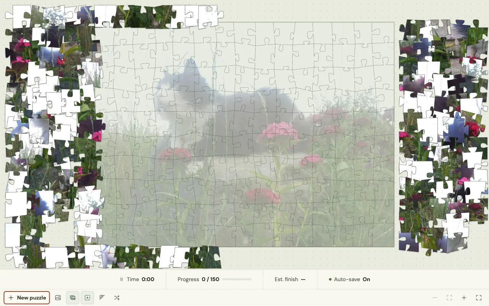
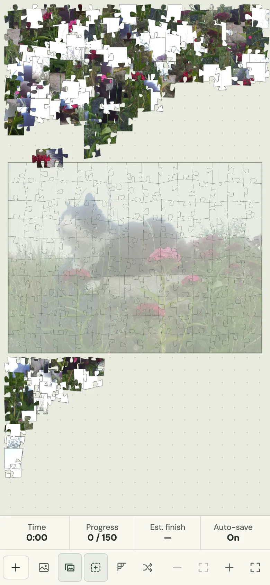
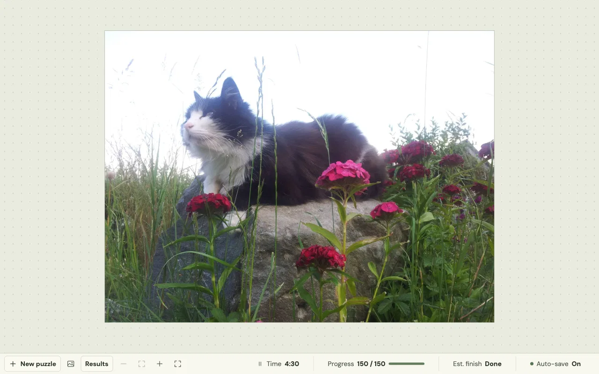

# Puzzle Dad

A full-screen jigsaw with 13 photos and a 150-piece default. [Play the latest version](https://laluka.github.io/puzzledad/) or [see a finished puzzle](assets/screenshots/completed.webp).

| Mobile table | Finished puzzle |
| --- | --- |
|  |  |

- Drag loose pieces around the table and snap them into place. You can also select a piece and tap its destination. With the keyboard, Tab to a piece, press Enter, move it with the arrow keys, and press Enter again to place it.
- Open **New puzzle** to change the photo, piece count (24 to 1,000), shape, cut pattern, or orientation. Classic cuts use varied tab sizes, positions, and depths. With shuffled orientation, click a piece or press R to rotate it clockwise by a quarter turn.
- Use the fullscreen button in the bottom toolbar to enter or leave browser fullscreen mode. Pieces glow when they reach the right spot with the correct orientation.
- Toggle the faint background photo and the placement frame separately in the toolbar.
- Drop an image on the table to add it to the photo shelf and open the setup dialog. The browser saves the current puzzle, loose-piece positions and rotations, results, and photos you add. The starter gallery is bundled with the site. Added photos stay in your browser.
- The bottom status bar estimates your local finish time after three placements using your recent pace. Results show active time, pieces per second and minute, and the average, variance, and root-mean-square change of placement gaps.

## Run locally

From the repository root, run `python3 -m http.server` and open `http://localhost:8000`. GitHub Pages serves the static files from the root of `main`. The `.nojekyll` file disables Jekyll.
